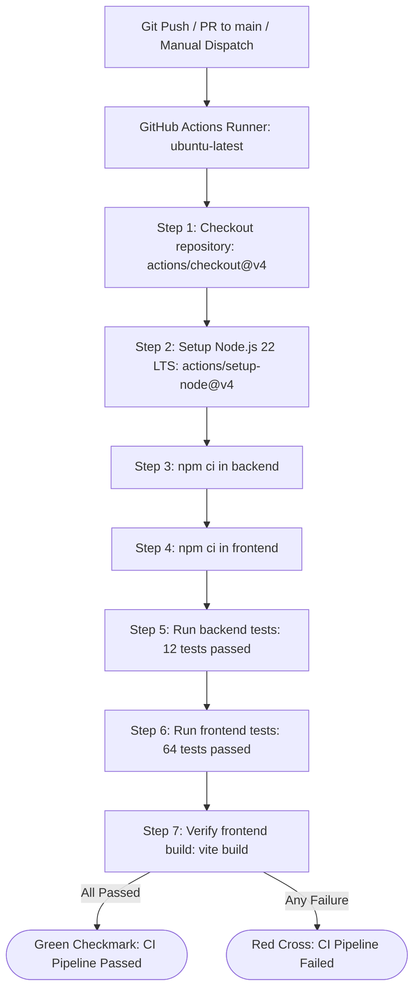

# Automated CI/CD Pipeline for a Student Management System

A production-grade, full-stack educational project demonstrating a modern Web Application, RESTful API, SQLite Database integration, comprehensive automated testing suites (76 tests across backend and frontend), Git version control, and continuous integration with **GitHub Actions**.

---

## Table of Contents

1. [Project Overview](#project-overview)
2. [Problem Statement & Objectives](#problem-statement--objectives)
3. [Key Features](#key-features)
4. [Technology Stack](#technology-stack)
5. [System Architecture](#system-architecture)
6. [Request and Data Flow](#request-and-data-flow)
7. [Directory Structure](#directory-structure)
8. [Prerequisites](#prerequisites)
9. [Installation Guide](#installation-guide)
10. [Running the Application](#running-the-application)
11. [Running Automated Tests](#running-automated-tests)
12. [Building for Production](#building-for-production)
13. [REST API Documentation](#rest-api-documentation)
14. [SQLite Database Management](#sqlite-database-management)
15. [Git, GitHub & CI/CD Pipeline](#git-github--cicd-pipeline)
16. [How to View GitHub Actions CI Results](#how-to-view-github-actions-ci-results)
17. [Troubleshooting Guide](#troubleshooting-guide)
18. [Project Limitations & Future Improvements](#project-limitations--future-improvements)
19. [College Demonstration Script](#college-demonstration-script)

---

## 1. Project Overview

The **Student Management System** is an enterprise-grade, lightweight web application that allows educational administrators, instructors, and department heads to view, add, edit, delete, search, filter, paginate, and export student records.

Beyond web development, the core focus of this project is **DevOps and Continuous Integration (CI)**: whenever code changes are pushed to GitHub or a pull request is created, an automated **GitHub Actions** workflow executes on an Ubuntu runner, sets up Node.js 22 LTS, installs dependencies, runs both backend and frontend test suites (76 automated tests in total), and validates the frontend production bundle before approving merges.

---

## 2. Problem Statement & Objectives

### Problem Statement
In traditional student registry workflows, manual record management leads to human error, lack of input validation, and data inconsistency. Furthermore, software projects often experience regressions during team collaboration without an automated CI mechanism to guarantee that newly committed code doesn't break existing functionality.

### Core Objectives
1. **Full-Stack CRUD Operations**: Create, Read, Update, and Delete student records with strict input validation on both frontend and backend.
2. **Persistent Local Database**: Store student data reliably using SQLite (`node:sqlite`) without complex external database servers or cloud dependencies.
3. **Enterprise UI/UX Features**: Administrator session authentication, dynamic Dark/Light mode theming, CSV report generation, client-side pagination, profile view, and loading skeletons.
4. **Comprehensive Automated Testing**: Maintain 100% passing test coverage (76 unit and integration tests across Node.js test runner and Vitest).
5. **Continuous Integration (CI)**: Implement an immutable GitHub Actions workflow that executes on every push and pull request.
6. **Clean Architecture & Maintainability**: Structure the monorepo cleanly with decoupled frontend and backend modules.

---

## 3. Key Features

- **Administrator Authentication & Portal**: Protected administrative access with dedicated sign-in view, auto-fill demo credentials helper, password visibility toggle, remember-me persistence, and session management.
  - *Admin Login ID*: `admin@studentportal.com` (or `admin`)
  - *Password*: `admin123` (or `admin@123`)
  - *Sign-out Controls*: Instant logout via topbar user pill or sidebar navigation.
- **Dynamic Dark & Light Mode Theming**:
  - Theme switcher button in header with smooth rotation animations and moon/sun SVG icons.
  - Automatic `localStorage` persistence (`student_portal_theme`) across browser reloads.
  - Accessible CSS custom properties with balanced contrast for cards, tables, inputs, and modals.
- **Student Profile Dossier (`#/students/:id`)**:
  - Dedicated student profile view showcasing academic standing, semester badge, contact details, registration date, and quick action shortcuts (`Edit Profile`, `Delete Student`, `← Back to Directory`).
- **One-Click Export to CSV**:
  - Direct client-side CSV export button on the directory toolbar.
  - Downloads formatted, sanitized files (`students_export_YYYY-MM-DD.csv`) containing current or filtered student records.
- **Client-Side Pagination**:
  - Configurable page navigation with previous/next controls, page number buttons, and dynamic record counters.
- **Animated Loading Skeletons**:
  - Smooth pulsating skeleton loaders (`LoadingSkeleton`) for table rows, summary cards, and profile views during async data fetching.
- **Enhanced Toast Notifications**:
  - Animated slide-in alert banners with auto-dismiss timers (`autoDismissMs`), dismiss button, and distinct styles for `success`, `error`, `info`, and `warning`.
- **Enhanced Sidebar Navigation**:
  - Active route highlighting, dynamic student count badge, tooltips, and accessible ARIA attributes.
- **Dashboard Overview (`#/`)**:
  - 4 real-time summary cards: *Total Students*, *Active Courses*, *Active Semesters*, and *Latest Enrolled Student*.
  - *Recent Enrollments Widget*: Compact preview table of the 5 most recent registrations with direct edit and profile view shortcuts.
- **Dedicated Student Directory (`#/students`)**:
  - Interactive table view with live record counter (`Showing Y of X students`).
  - Search by student name or email (instant case-insensitive filter).
  - Dynamic course dropdown filter populated from active programs.
  - Semester dropdown filter (Semesters 1 through 8).
  - Quick "Clear Filters" button with active filter counter.
- **Full Form Validation & Modals**:
  - Add Student dialog with field-level checks (name, email format, course, semester 1–8).
  - In-place Edit Student dialog prepopulated with record values.
  - Delete confirmation dialog with safety warnings.
  - Keyboard accessibility (dismiss via `Escape` key).
- **Backend Query Filters**:
  - Server-side support for query filtering (`GET /api/students?search=...&course=...&semester=...`).

---

## 4. Technology Stack

### Frontend
- **React 18** – Modern functional UI library with hooks (`useState`, `useEffect`, `useMemo`, `useCallback`).
- **Vite** – Lightning-fast bundler and local development environment with HMR.
- **Vanilla CSS3** – Responsive custom design system with dark/light theming, CSS variables, and zero bulky CSS framework dependencies.
- **Vitest & React Testing Library** – Next-generation test runner and DOM testing utilities configured with `jsdom` (64 automated tests).

### Backend
- **Node.js 22 (LTS)** – High-performance JavaScript server runtime.
- **Express.js** – Industry-standard RESTful API routing framework.
- **Node.js Built-in SQLite (`node:sqlite`)** – Embedded SQL database engine with zero external native compilation requirements.
- **Node.js Test Runner (`node:test`) & Supertest** – Built-in test runner paired with Supertest for end-to-end API assertions (12 automated tests).

### DevOps & Tools
- **Git** – Distributed version control.
- **GitHub** – Cloud Git repository hosting and pull request management.
- **GitHub Actions** – Multi-step CI pipeline executing test suites and production build on Ubuntu runners.
- **npm Workspaces & Concurrently** – Unified script management to start and test the entire stack with a single command.

---

## 5. System Architecture

The project follows a clean multi-tier client-server architecture with decoupled CI automation:

```
+-------------------------------------------------------------------------+
|                              React Frontend                             |
|  - Hash Router:                                                         |
|      * #/ (Dashboard)                                                   |
|      * #/students (Directory)                                           |
|      * #/students/:id (Student Profile Dossier)                         |
|  - Views & Components:                                                  |
|      * LoginPage, Header, Sidebar, SummaryCards                         |
|      * StudentTable, FilterToolbar, Pagination, ExportCsvButton          |
|      * StudentDetailView, StudentFormModal, DeleteConfirmModal          |
|      * DarkModeToggle, Notification, LoadingSkeleton                    |
|  - Vite Proxy: /api/* -> http://localhost:5000/api/*                    |
+-----------------------------------+-------------------------------------+
                                    |
                                    | HTTP REST (JSON over Fetch API)
                                    v
+-------------------------------------------------------------------------+
|                             Express REST API                            |
|  - App Factory (app.js) & Server Entry (server.js)                      |
|  - Input Validation & Query Filters (routes.js)                         |
|  - Endpoints: /api/health, /api/students, /api/students/:id             |
+-----------------------------------+-------------------------------------+
                                    |
                                    | Parameterized SQL Queries
                                    v
+-------------------------------------------------------------------------+
|                          Local SQLite Database                          |
|  - Table: students (id, name, email, course, semester, created_at)      |
|  - Engine: Built-in node:sqlite (WAL mode enabled)                      |
|  - Storage: backend/data/students.sqlite                                |
+-------------------------------------------------------------------------+
```

---

## 6. Request and Data Flow

```mermaid
flowchart TD
    User([User Browser]) -->|Interacts with UI| React[React Frontend: port 5173]
    React -->|Check Auth Session| AuthState{Authenticated?}
    AuthState -- No --> Login[Show LoginPage]
    AuthState -- Yes --> Views[Dashboard / Directory / Profile]
    Views -->|HTTP Request /api/students| ViteProxy[Vite Dev Proxy]
    ViteProxy -->|Forward to localhost:5000| Express[Express Backend API: port 5000]
    Express -->|Input & Query Validation| Validator{Valid?}
    Validator -- No -->|400 Bad Request| Express
    Validator -- Yes --> SQLite[(Local SQLite Database)]
    SQLite -->|SQL Result / Row Data| Express
    Express -->|JSON Response 200/201/404/409| React
    React -->|Update UI, Notify, or Export CSV| User
```

---

## 7. Directory Structure

```
cloud-project/
├── .github/
│   └── workflows/
│       └── ci.yml                          # GitHub Actions CI workflow definition
├── .gitignore                              # Excludes node_modules, *.sqlite*, dist, logs
├── package.json                            # Monorepo root scripts (dev, test, build, seed)
├── package-lock.json                       # Monorepo lockfile
├── README.md                               # Project documentation & viva guide
│
├── backend/
│   ├── data/
│   │   └── .gitkeep                        # SQLite storage directory (database excluded from git)
│   ├── scripts/
│   │   └── seed.js                         # Idempotent database seed script with diverse records
│   ├── src/
│   │   ├── app.js                          # Express application factory & middleware setup
│   │   ├── db.js                           # SQLite initialization & schema setup
│   │   ├── routes.js                       # REST API endpoints, query filters, validation
│   │   └── server.js                       # Server entry point listening on PORT 5000
│   ├── tests/
│   │   └── students.test.js                # 12 automated API tests using node:test & supertest
│   ├── package.json                        # Backend dependencies and scripts
│   └── package-lock.json                   # Backend dependency lockfile
│
└── frontend/
    ├── public/                             # Static assets
    ├── src/
    │   ├── components/
    │   │   ├── DarkModeToggle.jsx          # Theme switch button with localStorage persistence
    │   │   ├── DarkModeToggle.test.jsx     # Theme toggle test suite (3 tests)
    │   │   ├── DeleteConfirmModal.jsx      # Delete confirmation modal dialog
    │   │   ├── ExportCsvButton.jsx         # One-click directory CSV export button
    │   │   ├── ExportCsvButton.test.jsx    # CSV export test suite (4 tests)
    │   │   ├── FilterToolbar.jsx           # Search input and course/semester dropdowns
    │   │   ├── Header.jsx                  # Top navigation header, theme button & user profile
    │   │   ├── LoadingSkeleton.jsx         # Pulsating skeleton loading placeholders
    │   │   ├── LoginPage.jsx               # Administrator authentication login view
    │   │   ├── LoginPage.test.jsx          # Login view test suite (9 tests)
    │   │   ├── Notification.jsx            # Toast alerts with auto-dismiss timer
    │   │   ├── Pagination.jsx              # Client-side table pagination controls
    │   │   ├── Pagination.test.jsx         # Pagination test suite (4 tests)
    │   │   ├── RecentEnrollmentsTable.jsx  # Recent enrollments widget for Dashboard
    │   │   ├── Sidebar.jsx                 # Sidebar navigation with live student counter
    │   │   ├── StudentDetailView.jsx       # Student profile dossier view
    │   │   ├── StudentDetailView.test.jsx  # Student profile test suite (22 tests)
    │   │   ├── StudentFormModal.jsx        # Add/Edit student form dialog
    │   │   ├── StudentTable.jsx            # Student records directory table
    │   │   └── SummaryCards.jsx            # 4 metric summary cards
    │   ├── api.js                          # Centralized API fetch helper
    │   ├── App.jsx                         # Main application container, router, and state
    │   ├── App.test.jsx                    # Core app unit & integration tests (22 tests)
    │   ├── index.css                       # Complete CSS design system with dark/light themes
    │   ├── main.jsx                        # React DOM mounting entry point
    │   └── setupTests.js                   # Vitest jest-dom setup
    ├── index.html                          # Frontend HTML root
    ├── vite.config.js                      # Vite dev server, proxy, and Vitest configuration
    ├── package.json                        # Frontend dependencies and scripts
    └── package-lock.json                   # Frontend dependency lockfile
```

---

## 8. Prerequisites

Before running the project on your machine, make sure you have installed:
1. **Node.js**: Version 22.x or later (includes built-in `node:sqlite` and `node:test`).
   Check your version in your terminal:
   ```powershell
   node -v
   ```
2. **npm**: Version 10.x or later:
   ```powershell
   npm -v
   ```
3. **Git**: Installed and available in your terminal:
   ```powershell
   git --version
   ```

---

## 9. Installation Guide

Clone the repository and install dependencies for both frontend and backend:

```powershell
# 1. Install root workspace dependencies
npm install

# 2. Install backend dependencies
cd backend
npm install

# 3. Install frontend dependencies
cd ..\frontend
npm install

# 4. Return to root
cd ..
```

*(Alternatively, run `npm run install:all` from the root directory).*

---

## 10. Running the Application

You can start both servers simultaneously using the root runner, or run them in separate terminals.

### Option A: Run Both Together (Recommended)
From the root directory:
```powershell
npm run dev
```
This uses `concurrently` to launch the Express API on port `5000` and the Vite React server on port `5173`.

### Option B: Run in Two Separate Terminals
**Terminal 1 (Backend):**
```powershell
cd backend
npm start
```
*Backend runs at: `http://localhost:5000`*

**Terminal 2 (Frontend):**
```powershell
cd frontend
npm run dev
```
*Frontend runs at: `http://localhost:5173`*

Open your browser and navigate to:
👉 **`http://localhost:5173`**

### Administrator Credentials:
- **Email**: `admin@studentportal.com` (or `admin`)
- **Password**: `admin123` (or `admin@123`)
- *(Tip: Click the "Fill Admin Demo Credentials" button on the login screen for instant autofill).*

---

## 11. Running Automated Tests

The project includes **76 automated tests** across both backend and frontend suites.

### Run All Tests (Backend + Frontend)
From the root directory:
```powershell
npm test
```

### Run Backend Tests Only
Backend tests use Node.js's built-in test runner (`node:test`) and Supertest with an isolated in-memory SQLite database:
```powershell
# From root:
npm run test:backend

# Or from backend directory:
cd backend
npm test
```
**Backend Test Scenarios Covered (12/12 Passed):**
1. `GET /api/health` – Returns 200 and confirms database accessibility.
2. `GET /api/students` – Retrieves all student records.
3. `POST /api/students` – Successfully creates a student (201 Created).
4. `POST /api/students` – Rejects empty or whitespace-only name (400 Bad Request).
5. `POST /api/students` – Rejects invalid email format (400 Bad Request).
6. `POST /api/students` – Rejects semester outside 1–8 (400 Bad Request).
7. `POST /api/students` – Rejects duplicate email address (409 Conflict).
8. `GET /api/students/:id` – Retrieves student by ID (or 404 if not found).
9. `PUT /api/students/:id` – Updates an existing student record (200 OK).
10. `PUT /api/students/:id` – Rejects updates for non-existent student (404 Not Found).
11. `DELETE /api/students/:id` – Deletes a student record (200 OK).
12. `DELETE /api/students/:id` – Rejects deletion for non-existent student (404 Not Found).

### Run Frontend Tests Only
Frontend tests use Vitest and React Testing Library with mocked API endpoints:
```powershell
# From root:
npm run test:frontend

# Or from frontend directory:
cd frontend
npm test
```
**Frontend Test Suites Covered (64/64 Passed across 6 files):**
1. **`App.test.jsx` (22 tests)**:
   - Full dashboard rendering, metrics cards, and recent enrollments.
   - Authentication transitions from login screen to dashboard.
   - Client-side routing between Dashboard, Directory, and Profile views.
   - Real-time search by name and email (case-insensitive).
   - Course dropdown filtering and semester dropdown filtering.
   - Combined search and filters, and "Clear filters" restoration.
   - Student creation, editing, deletion with confirmation.
   - Form field validations and API error notification banners.
   - Modal escape-key dismissal and accessible keyboard handling.
2. **`LoginPage.test.jsx` (9 tests)**:
   - Login form rendering, credentials autofill helper.
   - Successful admin login with standard and alternative credentials.
   - Password visibility reveal toggle.
   - Validation for empty fields and incorrect credentials.
   - Remember Me functionality with `localStorage` persistence.
3. **`StudentDetailView.test.jsx` (22 tests)**:
   - Profile dossier rendering: student name, email, course, semester, ID.
   - Academic standing badge and status chips.
   - Back button navigation to directory.
   - Direct edit trigger and delete confirmation trigger.
   - Empty and error state handling for non-existent students.
4. **`Pagination.test.jsx` (4 tests)**:
   - Page calculation and pagination controls rendering.
   - Next and Previous button handling and boundary disabling.
   - Page number selection and active page indicator.
5. **`ExportCsvButton.test.jsx` (4 tests)**:
   - CSV export button rendering with dynamic record count badge.
   - Blob creation and simulated anchor download triggering.
   - Correct CSV header formatting and escaped student records.
6. **`DarkModeToggle.test.jsx` (3 tests)**:
   - Toggle button rendering with current theme indicator.
   - Theme switching between light and dark modes.
   - Persistence of theme preference in `localStorage`.

---

## 12. Building for Production

To test the frontend production build:
```powershell
npm run build
```
The optimized HTML, CSS, and JS files are generated in `frontend/dist/`.

---

## 13. REST API Documentation

### Base URL: `http://localhost:5000/api`

| Method | Endpoint | Query Parameters | Description | Success Status |
|---|---|---|---|---|
| `GET` | `/api/health` | — | Health check & DB status | `200 OK` |
| `GET` | `/api/students` | `?search=...&course=...&semester=...` | Get all students (supports server filtering) | `200 OK` |
| `GET` | `/api/students/:id` | — | Get single student by ID | `200 OK` |
| `POST` | `/api/students` | — | Create new student record | `201 Created` |
| `PUT` | `/api/students/:id` | — | Update existing student record | `200 OK` |
| `DELETE` | `/api/students/:id` | — | Delete student record | `200 OK` |

### Example Payloads & Responses

#### 1. Health Check
- **Request**: `GET /api/health`
- **Response**:
```json
{
  "status": "ok",
  "message": "Backend is running and database is accessible.",
  "timestamp": "2026-10-13T00:00:00.000Z"
}
```

#### 2. Create Student
- **Request**: `POST /api/students`
- **Body**:
```json
{
  "name": "Aarav Sharma",
  "email": "aarav.sharma@example.edu",
  "course": "Computer Science & Engineering",
  "semester": 6
}
```
- **Response (`201 Created`)**:
```json
{
  "success": true,
  "message": "Student created successfully.",
  "data": {
    "id": 1,
    "name": "Aarav Sharma",
    "email": "aarav.sharma@example.edu",
    "course": "Computer Science & Engineering",
    "semester": 6,
    "created_at": "2026-10-13 00:00:00"
  }
}
```

#### 3. Duplicate Email Error
- **Response (`409 Conflict`)**:
```json
{
  "success": false,
  "message": "A student with this email address already exists."
}
```

#### 4. Validation Error
- **Response (`400 Bad Request`)**:
```json
{
  "success": false,
  "message": "Validation failed.",
  "errors": [
    "A valid email address is required.",
    "Semester must be an integer between 1 and 8."
  ]
}
```

---

## 14. SQLite Database Management

The application stores data locally in SQLite at `backend/data/students.sqlite`.

### Automatic Schema Initialization
When the backend starts, it automatically initializes the database file and table if they do not exist:
```sql
CREATE TABLE IF NOT EXISTS students (
  id INTEGER PRIMARY KEY AUTOINCREMENT,
  name TEXT NOT NULL,
  email TEXT NOT NULL UNIQUE,
  course TEXT NOT NULL,
  semester INTEGER NOT NULL,
  created_at TEXT NOT NULL DEFAULT (datetime('now', 'localtime'))
);
```

### Seeding Sample Records
An idempotent seed script is provided to populate diverse test records across multiple courses and semesters:
```powershell
npm run seed
```
*(Running it multiple times safely skips existing email addresses).*

### Resetting the Database
To reset the development database:
```powershell
Remove-Item backend\data\students.sqlite* -Force
```
The database will be automatically re-created cleanly the next time the backend starts.

---

## 15. Git, GitHub & CI/CD Pipeline

### Core Concepts Explained

- **Git**: A local version control system that tracks revisions and history of code files.
- **GitHub**: A cloud platform hosting Git repositories that facilitates code review and collaboration.
- **Continuous Integration (CI)**: The automated engineering practice of testing every commit and pull request against automated verification suites before code is merged.
- **GitHub Actions**: Cloud automation platform running workflow jobs in isolated containers/VMs upon repository events (`push`, `pull_request`, `workflow_dispatch`).

### CI Workflow Architecture



The workflow file is located at `.github/workflows/ci.yml`.

---

## 16. How to View GitHub Actions CI Results

Once code is pushed to GitHub:
1. Open your repository in your web browser:
   `https://github.com/garvshrivastava24/cloud-project`
2. Click on the **Actions** tab at the top.
3. You will see a workflow run named **Student Management System CI**.
4. Click on the workflow run to view the execution logs for backend tests, frontend tests, and the production build.
5. A **green checkmark** indicates all **76 automated tests passed** (12 backend + 64 frontend) and the production build completed with 0 errors!

---

## 17. Troubleshooting Guide

- **Port 5000 is already in use:**
  If another process is using port 5000, start the backend with a custom port:
  ```powershell
  $env:PORT=5001; npm start
  ```
- **Vite Proxy errors (`ECONNREFUSED`):**
  Ensure the backend server is running on port 5000 before initiating requests from the frontend.
- **Database file locked:**
  Close any external SQLite viewer software before restarting the backend server.
- **Tests show experimental warning:**
  The `ExperimentalWarning: SQLite is an experimental feature` warning is a standard diagnostic in Node.js LTS and does not cause test failures (exit code is 0).

---

## 18. Project Limitations & Future Improvements

### Completed Improvements
- [x] **Administrator Authentication**: Secure sign-in portal with session persistence and autofill demo helper.
- [x] **Dark Mode / Light Mode Theming**: Full CSS custom properties theme toggle with `localStorage` persistence.
- [x] **Student Profile Dossier**: Dedicated detail view (`#/students/:id`) with academic status cards and direct actions.
- [x] **Export to CSV**: One-click download of student records with timestamped filename.
- [x] **Client-Side Pagination**: Smooth table pagination with configurable page controls.
- [x] **Loading Skeletons & Auto-dismiss Toast Alerts**: Modern UI feedback for data loading and API operations.
- [x] **Backend Query Filtering**: Search and course filtering directly on backend endpoints.

### Future Improvements
- [ ] Role-based Access Control (Admin vs. Faculty vs. Student portals).
- [ ] Profile picture uploads with image compression and storage.
- [ ] Containerized deployment using Docker and Docker Compose.
- [ ] Automated Continuous Deployment (CD) pipeline to cloud platforms (AWS/Render/Vercel).

---

## 19. College Demonstration Script

For your college viva or practical evaluation, follow this 5-step demonstration flow:

1. **Show Architecture & Version Control**:
   - Show the clean separation between `frontend/` (React 18 + Vite) and `backend/` (Express + SQLite).
   - Show `.github/workflows/ci.yml` and explain how continuous integration prevents regressions.
2. **Execute Automated Tests Live**:
   - Run `npm test` from the root.
   - Point out that **all 76 tests pass** (12 backend API tests + 64 frontend component/integration tests across 6 test suites) with 0 failures.
3. **Demonstrate Web Application & UI Features**:
   - Run `npm run dev` and open `http://localhost:5173`.
   - **Login**: Show the admin sign-in screen, click "Fill Admin Demo Credentials", and log in.
   - **Theming**: Click the Sun/Moon toggle in the top right to demonstrate dynamic Dark/Light mode switching.
   - **Dashboard**: Review the 4 metric cards and recent enrollments table.
   - **Student Directory**: Navigate to `#/students`. Demonstrate the live search bar, course dropdown, and semester dropdown.
   - **Pagination**: Show page switching and record counters.
   - **CSV Export**: Click "Export CSV" to download the current student directory as an Excel-compatible CSV file.
   - **Student Profile**: Click "View Profile" on any student to open the comprehensive dossier view (`#/students/:id`).
   - **CRUD**: Add a student with invalid fields to demonstrate validation; add a valid student; edit their details; delete a record using the confirmation modal.
4. **Demonstrate Data Persistence**:
   - Stop and restart the backend server.
   - Refresh the page to prove that SQLite retained all newly inserted/updated records.
5. **Demonstrate Continuous Integration in GitHub Actions**:
   - Show the GitHub Actions tab in your repository with green checkmarks on recent commits.
   - Explain how GitHub Actions executes on every git push to verify code stability automatically.
thank you