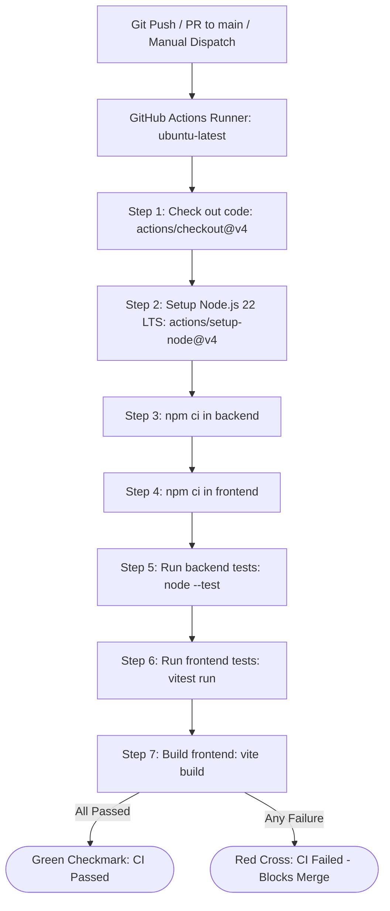

# Automated CI/CD Pipeline for a Student Management System

A beginner-friendly, full-stack college project demonstrating a complete Web Application, RESTful API, SQLite Database integration, automated testing suites, Git version control, and continuous integration with **GitHub Actions**.

---

## Table of Contents

1. [Project Overview](#project-overview)
2. [Problem Statement & Objectives](#problem-statement--objectives)
3. [Key Features](#key-features)
4. [Technology Stack](#technology-stack)
5. [System Architecture](#system-architecture)
6. [Request and Data Flow](#request-and-data-flow)
7. [Directory Structure](#directory-structure)
8. [Prerequisites](#prerequisites)
9. [Installation Guide](#installation-guide)
10. [Running the Application](#running-the-application)
11. [Running Automated Tests](#running-automated-tests)
12. [Building for Production](#building-for-production)
13. [REST API Documentation](#rest-api-documentation)
14. [SQLite Database Management](#sqlite-database-management)
15. [Git, GitHub & CI/CD Pipeline](#git-github--cicd-pipeline)
16. [How to View GitHub Actions CI Results](#how-to-view-github-actions-ci-results)
17. [Troubleshooting Guide](#troubleshooting-guide)
18. [Project Limitations & Future Improvements](#project-limitations--future-improvements)
19. [College Demonstration Script](#college-demonstration-script)

---

## 1. Project Overview

The **Student Management System** is a lightweight web application that allows educational administrators or instructors to view, add, edit, delete, and search student records.

Beyond standard web development, the core focus of this project is **DevOps and Continuous Integration (CI)**: whenever code changes are pushed to GitHub or a pull request is created, an automated **GitHub Actions** workflow checks out the repository, installs dependencies, and runs automated backend and frontend test suites to guarantee code stability before merging.

---

## 2. Problem Statement & Objectives

### Problem Statement
In traditional student registry workflows, manual record management leads to human error, lack of validation, and data inconsistency. Furthermore, software projects often break during team collaboration without an automated mechanism to verify that new code doesn't break existing functionality.

### Core Objectives
1. **Full-Stack CRUD Operations**: Create, Read, Update, and Delete student records with input validation.
2. **Persistent Local Database**: Store student data reliably using SQLite without complex database setup or cloud dependencies.
3. **Automated Testing**: Write comprehensive automated unit and integration tests for both backend endpoints and frontend components.
4. **Continuous Integration (CI)**: Implement a working GitHub Actions workflow that runs automated tests on every push and pull request.
5. **Clean Architecture & Maintainability**: Structure the monorepo cleanly with separate concerns between frontend and backend.

---

## 3. Key Features

- **Dashboard Overview (`#/`)**: High-level administrative dashboard with quick action buttons (`+ Add Student`, `Browse Directory →`) and recent enrollments overview.
- **4 Real-Time Summary Cards**:
  1. *Total Students*: Dynamic count of all enrolled scholars.
  2. *Active Courses*: Count of distinct academic programs offered.
  3. *Active Semesters*: Count of unique semesters represented (1–8).
  4. *Latest Enrolled*: Displays the name and date of the most recently registered student.
- **Recent Enrollments Widget**: Compact table on the Dashboard showing the 5 most recent registrations with quick edit links and a direct shortcut to the directory.
- **Dedicated Student Directory (`#/students`)**: Full administrative table view with live record counter (`Total Students: X` or `Showing Y of X students`).
- **Academic Filters & Live Search**:
  - Live, case-insensitive search by student name or email address.
  - Course dropdown filter dynamically populated from active academic programs.
  - Semester dropdown filter (Semesters 1 through 8).
  - One-click Clear Filters button (`Clear (X)`).
- **Client-Side Hash Routing**: Browser Back/Forward navigation support and persistent state on page reload (`#/` and `#/students`) without server routing configuration.
- **Add Student Modal**: Form dialog with field-level validation (name, email format, course, semester 1–8).
- **Edit Student Modal**: Prepopulates student record for in-place updates.
- **Delete Confirmation Modal**: Prevents accidental record deletion with explicit confirmation.
- **User Feedback**: Non-intrusive success and error notification banners for all API actions.
- **Loading & Empty States**: Clean feedback during async operations, when zero records exist, and when no records match active filter criteria.

---

## 4. Technology Stack

### Frontend
- **React 18** – Modern UI library using functional components and hooks (`useState`, `useEffect`, `useMemo`).
- **Vite** – Ultra-fast development server and production bundler.
- **CSS3** – Responsive custom design system with dark sidebar and accessible contrast.
- **Vitest & React Testing Library** – Modern testing framework with `jsdom` for frontend unit and integration tests.

### Backend
- **Node.js 22 (LTS)** – Server runtime.
- **Express.js** – Minimalist, robust REST API framework.
- **Node.js Built-in SQLite (`node:sqlite`)** – Fast embedded SQL database engine requiring no native C++ rebuilds.
- **Node.js Test Runner (`node:test`) & Supertest** – Built-in test runner combined with HTTP assertion library for backend API testing.

### DevOps & Tools
- **Git** – Distributed version control.
- **GitHub** – Remote code repository and collaboration platform.
- **GitHub Actions** – Automated CI pipeline executing test suites and production build on Ubuntu runners.
- **npm** – Node package manager managing frontend, backend, and monorepo scripts.

---

## 5. System Architecture

The project is structured as a two-tier application with an isolated CI pipeline:

```
+-------------------------------------------------------------+
|                      React Frontend                         |
|  - Hash Router: #/ (Dashboard) and #/students (Directory)   |
|  - SummaryCards, RecentEnrollmentsTable, StudentTable       |
|  - FilterToolbar, StudentFormModal, DeleteConfirmModal      |
|  - Vite Proxy: /api/* -> http://localhost:5000/api/*        |
+------------------------------+------------------------------+
                               |
                               | HTTP JSON Requests (Fetch API)
                               v
+-------------------------------------------------------------+
|                     Express REST API                        |
|  - App factory (app.js) & Server entry (server.js)          |
|  - Validation & Route Handlers (routes.js)                  |
+------------------------------+------------------------------+
                               |
                               | Parameterized SQL Queries
                               v
+-------------------------------------------------------------+
|                    Local SQLite Database                    |
|  - Table: students (id, name, email, course, sem, created)  |
|  - Storage: backend/data/students.sqlite                    |
+-------------------------------------------------------------+
```

---

## 6. Request and Data Flow

```mermaid
flowchart TD
    User([User Browser]) -->|Actions: Add, Search, Filter, Edit, Delete| React[React Frontend: port 5173]
    React -->|Fetch /api/students| ViteProxy[Vite Proxy Server]
    ViteProxy -->|Forward to localhost:5000| Express[Express Backend API: port 5000]
    Express -->|Input Validation| Validator{Valid Input?}
    Validator -- No -->|400 Bad Request| Express
    Validator -- Yes --> SQLite[(Local SQLite Database)]
    SQLite -->|SQL Result / Row Data| Express
    Express -->|JSON Response 200/201/404/409| React
    React -->|Update UI State & Display Alert| User
```

---

## 7. Directory Structure

```
cloud-project/
├── .github/
│   └── workflows/
│       └── ci.yml               # GitHub Actions CI workflow definition
├── .gitignore                   # Excludes node_modules, *.sqlite*, build dist, logs
├── package.json                 # Monorepo root scripts (dev, test, build, seed)
├── package-lock.json            # Monorepo lockfile
├── README.md                    # Project documentation
│
├── backend/
│   ├── data/
│   │   └── .gitkeep             # SQLite storage directory (database excluded from git)
│   ├── scripts/
│   │   └── seed.js              # Idempotent database seed script
│   ├── src/
│   │   ├── app.js               # Express application factory & middleware setup
│   │   ├── db.js                # SQLite initialization & schema setup
│   │   ├── routes.js            # REST API endpoints & input validation
│   │   └── server.js            # Server entry point listening on PORT 5000
│   ├── tests/
│   │   └── students.test.js     # 12 automated API tests using node:test and supertest
│   ├── package.json             # Backend dependencies and scripts
│   └── package-lock.json        # Backend dependency lockfile
│
└── frontend/
    ├── public/                  # Static assets
    ├── src/
    │   ├── components/
    │   │   ├── DeleteConfirmModal.jsx      # Delete confirmation dialog
    │   │   ├── FilterToolbar.jsx           # Search input and course/semester dropdowns
    │   │   ├── Header.jsx                  # Top navigation header & active view badge
    │   │   ├── Notification.jsx            # Alert banners for operations
    │   │   ├── RecentEnrollmentsTable.jsx  # Recent enrollments widget for Dashboard
    │   │   ├── Sidebar.jsx                 # Dark sidebar with Dashboard & Students nav
    │   │   ├── StudentFormModal.jsx        # Add/Edit student form dialog
    │   │   ├── StudentTable.jsx            # Student records directory table
    │   │   └── SummaryCards.jsx            # 4 metric summary cards
    │   ├── api.js               # Centralized API fetch helper
    │   ├── App.jsx              # Main dashboard container & hash router
    │   ├── App.test.jsx         # 16 frontend unit & integration tests
    │   ├── index.css            # Custom CSS styling and responsive grid
    │   ├── main.jsx             # React DOM mounting entry point
    │   └── setupTests.js        # Vitest jest-dom setup
    ├── index.html               # Frontend HTML root
    ├── vite.config.js           # Vite dev server, proxy, and Vitest config
    ├── package.json             # Frontend dependencies and scripts
    └── package-lock.json        # Frontend dependency lockfile
```

---

## 8. Prerequisites

Before running the project on your Windows computer, make sure you have installed:
1. **Node.js**: Version 22.x or later (includes built-in `node:sqlite` and `node:test`).
   Check your version in Windows PowerShell:
   ```powershell
   node -v
   ```
2. **npm**: Version 10.x or later:
   ```powershell
   npm -v
   ```
3. **Git**: Installed and available in PowerShell:
   ```powershell
   git --version
   ```

---

## 9. Installation Guide

Open Windows PowerShell, navigate to the project directory, and install dependencies for both frontend and backend:

```powershell
# 1. Install root workspace dependencies
npm install

# 2. Install backend dependencies
cd backend
npm install

# 3. Install frontend dependencies
cd ..\frontend
npm install

# 4. Return to root
cd ..
```

*(Alternatively, run `npm run install:all` from the root directory).*

---

## 10. Running the Application

You can start both servers simultaneously using the root runner, or run them in separate terminals.

### Option A: Run Both Together (Recommended)
From the root `cloud-project` directory:
```powershell
npm run dev
```
This uses `concurrently` to launch the Express API on port `5000` and the Vite React server on port `5173`.

### Option B: Run in Two Separate Terminals
**Terminal 1 (Backend):**
```powershell
cd e:\cloud-project\backend
npm start
```
*Backend runs at: `http://localhost:5000`*

**Terminal 2 (Frontend):**
```powershell
cd e:\cloud-project\frontend
npm run dev
```
*Frontend runs at: `http://localhost:5173`*

Open your browser and navigate to:
👉 **`http://localhost:5173`**

---

## 11. Running Automated Tests

All tests are verified and fully automated.

### Run All Tests (Backend + Frontend)
From the root directory:
```powershell
npm test
```

### Run Backend Tests Only
Backend tests use Node.js's built-in test runner (`node:test`) and Supertest with an isolated in-memory SQLite database:
```powershell
# From root:
npm run test:backend

# Or from backend directory:
cd backend
npm test
```
**Backend Test Scenarios Covered (12/12 Passed):**
1. `GET /api/health` – Returns 200 and confirms database accessibility.
2. `GET /api/students` – Retrieves student records.
3. `POST /api/students` – Successfully creates a student (201 Created).
4. `POST /api/students` – Rejects empty or whitespace-only name (400 Bad Request).
5. `POST /api/students` – Rejects invalid email format (400 Bad Request).
6. `POST /api/students` – Rejects semester outside 1–8 (400 Bad Request).
7. `POST /api/students` – Rejects duplicate email address (409 Conflict).
8. `GET /api/students/:id` – Retrieves student by ID (or 404 if not found).
9. `PUT /api/students/:id` – Updates an existing student record (200 OK).
10. `PUT /api/students/:id` – Rejects updates for non-existent student (404 Not Found).
11. `DELETE /api/students/:id` – Deletes a student record (200 OK).
12. `DELETE /api/students/:id` – Rejects deletion for non-existent student (404 Not Found).

### Run Frontend Tests Only
Frontend tests use Vitest and React Testing Library with mocked API endpoints:
```powershell
# From root:
npm run test:frontend

# Or from frontend directory:
cd frontend
npm test
```
**Frontend Test Scenarios Covered (16/16 Passed):**
1. Renders dashboard layout, sidebar, header, and 4 summary cards.
2. Navigates between Dashboard and Students pages when clicking sidebar items.
3. Handles browser hash navigation for `#/students`, `#/`, and page refreshes.
4. Renders student records in directory table and live counter accurately.
5. Searches students by name or email case-insensitively.
6. Filters students by course dropdown correctly.
7. Filters students by semester dropdown correctly.
8. Filters by combined search text, course, and semester simultaneously.
9. Restores all students when "Clear filters" is clicked.
10. Displays contextual empty state when no students match active search/filters.
11. Submits a new student via modal and updates directory and summary cards.
12. Opens edit modal and updates existing student record in place.
13. Deletes a student record after modal confirmation.
14. Validates required form fields before submission.
15. Displays user-friendly error notification when API fails.
16. Accessibility: dismisses modal dialog when pressing Escape key.

---

## 12. Building for Production

To test the frontend production build:
```powershell
npm run build
```
The optimized HTML, CSS, and JS files are generated in `frontend/dist/`.

---

## 13. REST API Documentation

### Base URL: `http://localhost:5000/api`

| Method | Endpoint | Description | Success Status |
|---|---|---|---|
| `GET` | `/api/health` | Health check & DB status | `200 OK` |
| `GET` | `/api/students` | Get all students | `200 OK` |
| `GET` | `/api/students/:id` | Get student by ID | `200 OK` |
| `POST` | `/api/students` | Create new student | `201 Created` |
| `PUT` | `/api/students/:id` | Update existing student | `200 OK` |
| `DELETE` | `/api/students/:id` | Delete student | `200 OK` |

### Example Payloads & Responses

#### 1. Health Check
- **Request**: `GET /api/health`
- **Response**:
```json
{
  "status": "ok",
  "message": "Backend is running and database is accessible.",
  "timestamp": "2026-10-11T09:30:43.956Z"
}
```

#### 2. Create Student
- **Request**: `POST /api/students`
- **Body**:
```json
{
  "name": "Garv Shrivastava",
  "email": "garv@example.edu",
  "course": "Computer Science & Engineering",
  "semester": 6
}
```
- **Response**:
```json
{
  "success": true,
  "message": "Student created successfully.",
  "data": {
    "id": 1,
    "name": "Garv Shrivastava",
    "email": "garv@example.edu",
    "course": "Computer Science & Engineering",
    "semester": 6,
    "created_at": "2026-10-11 15:00:00"
  }
}
```

#### 3. Duplicate Email Error
- **Response (`409 Conflict`)**:
```json
{
  "success": false,
  "message": "A student with this email address already exists."
}
```

#### 4. Validation Error
- **Response (`400 Bad Request`)**:
```json
{
  "success": false,
  "message": "Validation failed.",
  "errors": [
    "A valid email address is required.",
    "Semester must be an integer between 1 and 8."
  ]
}
```

---

## 14. SQLite Database Management

The application stores data locally in SQLite at `backend/data/students.sqlite`.

### Automatic Schema Initialization
When the backend starts, it automatically creates the database file and table if they do not exist:
```sql
CREATE TABLE IF NOT EXISTS students (
  id INTEGER PRIMARY KEY AUTOINCREMENT,
  name TEXT NOT NULL,
  email TEXT NOT NULL UNIQUE,
  course TEXT NOT NULL,
  semester INTEGER NOT NULL,
  created_at TEXT NOT NULL DEFAULT (datetime('now', 'localtime'))
);
```

### Seeding Sample Records
An idempotent seed script is provided to populate test records without creating duplicates:
```powershell
npm run seed
```
*(Running it multiple times safely skips existing email addresses).*

### Resetting the Database
To reset the development database to an empty state:
```powershell
Remove-Item backend\data\students.sqlite* -Force
```
The database will be automatically re-created cleanly the next time the backend starts.

---

## 15. Git, GitHub & CI/CD Pipeline

### Beginner-Friendly Concepts

- **Git**: A local tool on your computer that tracks versions and history of your code files.
- **GitHub**: An online cloud platform that hosts Git repositories and enables team collaboration.
- **Continuous Integration (CI)**: The automated practice of verifying each code change (commit, push, or pull request) by running automated tests. If a test fails, developers are immediately alerted.
- **Continuous Delivery / Continuous Deployment (CD)**: The automated practice of packaging and releasing verified code to a staging or production server. *(Note: This college project strictly focuses on Continuous Integration).*
- **GitHub Actions**: GitHub's built-in automation service that runs tasks (workflows) inside virtual machines whenever events occur in your repository.

### CI Workflow Architecture



The workflow file is located at `.github/workflows/ci.yml`.

---

## 16. How to View GitHub Actions CI Results

Once code is pushed to GitHub:
1. Open your repository in your web browser:
   `https://github.com/garvshrivastava24/cloud-project`
2. Click on the **Actions** tab at the top.
3. You will see a workflow run named **Student Management System CI**.
4. Click on the workflow run to view the execution logs for both backend and frontend tests.
5. A **green checkmark** indicates all 28 automated tests passed and the production build succeeded!

---

## 17. Troubleshooting Guide

- **Port 5000 is already in use:**
  If another process is using port 5000, start the backend with a custom port:
  ```powershell
  $env:PORT=5001; npm start
  ```
- **Vite Proxy errors (`ECONNREFUSED`):**
  Ensure the backend server is running on port 5000 before initiating requests from the frontend.
- **Database file locked:**
  Close any external SQLite viewer software before restarting the backend server.
- **Tests fail with experimental warning:**
  The `ExperimentalWarning: SQLite is an experimental feature` warning is a standard diagnostic in Node.js LTS and does not cause test failures (exit code is 0).

---

## 18. Project Limitations & Future Improvements

### Current Limitations
- Designed for single-tenant local operation (no multi-tenant authentication).
- SQLite WAL mode is configured for local single-process access.
- In-memory client-side pagination (suitable for up to a few thousand student records).

### Future Improvements
- Role-based Access Control (Admin vs. Faculty vs. Student view).
- Export student records to CSV and PDF formats.
- Profile picture uploads with image compression.
- Containerized staging deployment using Docker.

---

## 19. College Demonstration Script

For your college viva or practical evaluation, follow this 4-step demonstration flow:

1. **Show Version Control & Architecture**:
   - Explain the clean separation between `frontend/` (React + Vite) and `backend/` (Express + SQLite).
   - Point out `.github/workflows/ci.yml` and the triggers (`push`, `pull_request`, `workflow_dispatch`).
2. **Execute Automated Tests Live**:
   - Run `npm test` from the root.
   - Highlight the 12 backend test cases and 16 frontend unit tests (28 total) passing with 0 failures.
3. **Demonstrate Web Application & Persistence**:
   - Run `npm run dev` and open `http://localhost:5173`.
   - Show the **Dashboard** overview, summary metric cards, and recent enrollments table.
   - Navigate to **Students** directory using the sidebar or quick link.
   - Filter by Course and Semester, and demonstrate the dynamic counter.
   - Add a new student record (demonstrating validation errors by attempting invalid inputs).
   - Edit the record and verify instant UI updates.
   - Search for the student using the search bar.
   - Stop and restart the backend to demonstrate that the data was saved in SQLite and did not disappear.
   - Delete the student using the confirmation modal.
4. **Demonstrate Continuous Integration in GitHub**:
   - Show the GitHub Actions tab in your browser with the green CI build badge.
   CI Trigger Test: GitHub Actions runs automatically on push.
